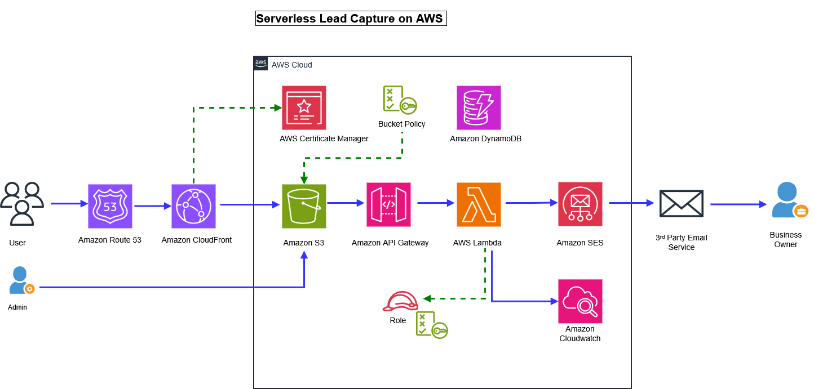

# 📚 EpicReads Serverless AWS Architecture

A secure, highly available, and fully serverless web application hosted on AWS. This project demonstrates static website hosting via Amazon S3 and CloudFront, paired with a dynamic serverless backend utilizing AWS Lambda, Amazon SES (Email Service), API Gateway, and Amazon DynamoDB.

---

## 🏗️ Architecture Overview

> **Architecture Diagram:**
> 

### **Key Components & Flow:**
1. **Frontend Hosting:** Static files (`index.html`, `404.html`) hosted in an **Amazon S3** bucket, served globally via **Amazon CloudFront** with Custom Domain & SSL Certificate via **AWS ACM** and **Route 53**.
2. **Dynamic Contact Form:** User submissions hit **Amazon API Gateway**, triggering an **AWS Lambda** function.
3. **Email & Data Storage:** The Lambda function processes the payload, sends notification emails via **Amazon SES**, and saves contact logs to **Amazon DynamoDB**.

---

## 🛠️ Phase 1: Static Website Hosting (S3 + CloudFront + Route 53)

### Step 1: Initialize S3 Bucket & Upload Static Files
```bash
# Configure AWS CLI
aws configure

# Create S3 bucket
aws s3 mb s3://epicreads-test2 --region us-east-1

# Sync local website files to S3
aws s3 sync . s3://epicreads-test2
```

### Step 2: Configure Bucket Policy & Website Hosting

Enable static website hosting on the S3 bucket and attach a public read bucket policy:

```json
{
    "Version": "2012-10-17",
    "Statement": [
        {
            "Sid": "PublicReadGetObject",
            "Effect": "Allow",
            "Principal": "*",
            "Action": ["s3:GetObject"],
            "Resource": ["arn:aws:s3:::Bucket-Name/*"]
        }
    ]
}
```

### Step 3: SSL Certificate & CloudFront Distribution

* **ACM:** Requested a public SSL certificate in us-east-1 with DNS validation via Route 53 CNAME records.

* **CloudFront:** Created a distribution (theepicbooks) pointing to the S3 bucket origin, enforced HTTPS, and updated S3 bucket policy to restrict access exclusively to CloudFront.

* **Route 53:** Created an Alias A Record pointing your custom domain (example.com) directly to the CloudFront distribution endpoint.

## ⚡ Phase 2: Implementing Dynamic 'Contact Us' (API Gateway + Lambda + SES)
### Step 1: Amazon SES Setup

* Created and verified sender and receiver email identities in Amazon SES.

### Step 2: IAM Security Roles & Policies

* Created an IAM Policy (`Epicreads_SES_policy`) granting CloudWatch logging and SES email dispatch permissions, attached to an IAM Role (`Epicreads_role`) for Lambda. Additionally, added dynamodb:Scan permissions for data retrieval.

```json
{
  "Version": "2012-10-17",
  "Statement": [
    {
      "Sid": "CloudWatchLogsBasic",
      "Effect": "Allow",
      "Action": ["logs:CreateLogGroup"],
      "Resource": "*"
    },
    {
      "Sid": "CloudWatchLogsStreamEvents",
      "Effect": "Allow",
      "Action": ["logs:CreateLogStream","logs:PutLogEvents"],
      "Resource": "*"
    },
    {
      "Sid": "AllowSesSendEmail",
      "Effect": "Allow",
      "Action": ["ses:SendEmail","ses:SendRawEmail"],
      "Resource": "*"
    }
  ]
}
```
IAM Permissions for DynamoDB (inline policy)
```json
{
    "Version": "2012-10-17",
    "Statement": [
        {
            "Effect": "Allow",
            "Action": [
                "dynamodb:PutItem",
                "dynamodb:Scan"
            ],
            "Resource": "*"
        }
    ]
}
```

### Step 3: AWS Lambda Function (epicreads_contactus)

* Created a Node.js Lambda function (`epicreads_contactus.mjs`) configured with `Epicreads_role` to parse incoming form payloads and trigger SES emails.


### Step 4: API Gateway & Frontend Integration

* **API Gateway:** Created a REST API (`Epicreads_api`) with a resource (`/epicreads_resource`) and a `POST` and `GET` method integrated with the Lambda function (Lambda Proxy Integration enabled).

* **CORS:** Enabled CORS on API Gateway to accept requests from your CloudFront domain.

* **Deployment:** Deployed the API to a stage (`dev`).

* **Frontend:** Updated website JavaScript `fetch()` calls to point to your API Gateway invoke URL.

## 📊 Phase 3: Data Management & Dynamic Table Rendering (DynamoDB + API Gateway)

### Step 1: Create DynamoDB Table
* Created a DynamoDB table to store and retrieve contact submissions:
```bash
aws dynamodb create-table \
    --table-name ContactMessages \
    --attribute-definitions AttributeName=id,AttributeType=S \
    --key-schema AttributeName=id,KeyType=HASH \
    --billing-mode PAY_PER_REQUEST \
    --region us-east-1
```


### 🌐 Live Demo & Testing

* **Website URL:** https://d1czu8hrz59auw.cloudfront.net/

* **API Endpoint:** https://<YOUR-API>.execute-api.us-east-1.amazonaws.com/dev/epicreads_resource

📝 Author: 
**Sabin Shrestha**